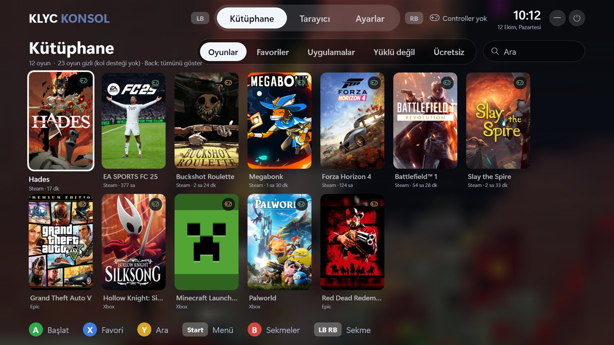
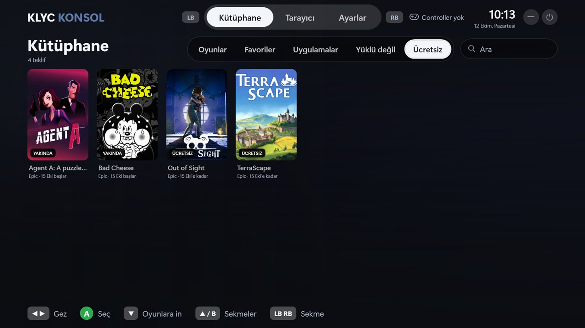
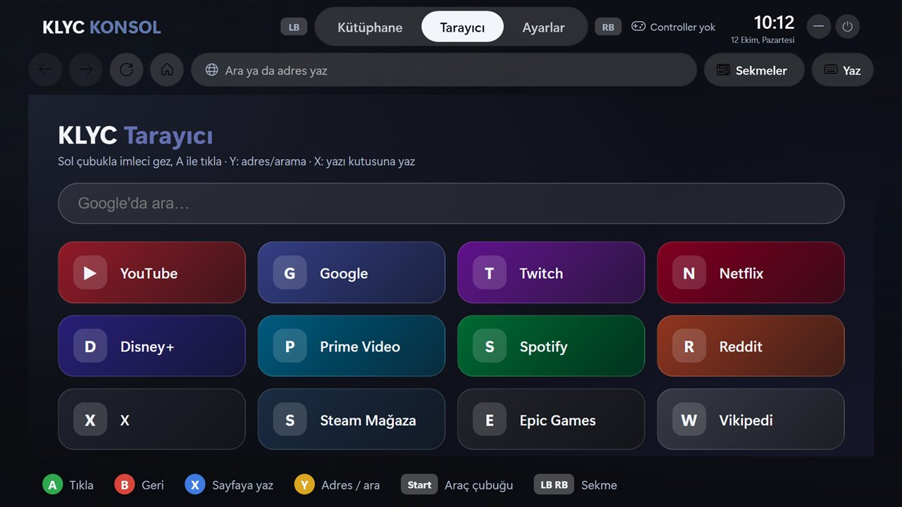

<div align="center">


# KLYC Konsol

**Controller ile PC'yi konsol gibi kullan: oyunlar, tarayıcı ve ayarlar tek yerde, fare ve klavyesiz.**
PS5 / Big Picture tarzı tam ekran arayüz. Oyun açılınca kendini kapatıp bilgisayarı oyuna bırakır.

[](https://github.com/ernklyc/klyc-konsol/actions/workflows/build.yml)
[](https://github.com/ernklyc/klyc-konsol/releases)


**Türkçe** · Kardeş proje: [KLYC-Pulse](https://github.com/ernklyc/klyc-pulse) (performans, ısı ve bakım yöneticisi)



</div>

---

## İçindekiler

[Neden](#neden) · [Özellikler](#özellikler) · [İndir ve kur](#indir-ve-kur) · [Kullanım](#kullanım) · [Oyun modu](#oyun-modu) · [Uyumluluk](#uyumluluk) · [Gizlilik](#gizlilik) · [SSS](#sık-sorulan-sorular) · [Sorun giderme](#sorun-giderme) · [Kaynaktan derleme](#kaynaktan-derleme) · [Katkı](#katkı) · [Lisans](#lisans)

## Neden?

Kanepeden oynarken oyun seçmek, tarayıcıda bir şey açmak ya da Wi‑Fi'a bağlanmak için kalkıp fareye uzanmak gerekir. Mevcut tam ekran
arayüzler ya ağır, ya tek bir mağazaya bağlı, ya da oyun sırasında arka planda kaynak tüketir. **KLYC Konsol** tüm mağazalarındaki oyunları tek
kütüphanede toplar, yalnızca controller ile çalışanları gösterir, uygulama içinde gerçek bir tarayıcı sunar ve oyun başlayınca kendini
arka plana çekip yükünü en aza indirir.

## Özellikler

| Alan | Ne yapar |
|---|---|
| **Kütüphane** | Steam, Epic, Xbox / Game Pass, EA App, Riot, GOG, Ubisoft Connect, Battle.net ve kısayol klasörü tek yerde; aynı oyun birden çok mağazadaysa tek kart. **Yalnızca kol destekli** oyunlar listelenir (Steam verisi; elle düzeltilebilir). Tam 2:3 kapaklar, favoriler, **son oynananlar**, **sıralama** (akıllı / son oynanan / A-Z / en çok oynanan), arama, oynama süresi. Yeni kurulan oyun kendiliğinden bulunur. |
| **Yüklü değil** | Steam hesabında oynadığın ama kurulu olmayan, kol destekli oyunlar. A'ya basınca Steam'de indirme başlar. |
| **Ücretsiz** | Epic'in şu an ve yakında ücretsiz verdiği oyunlar; A'ya basınca mağaza sayfası Konsol tarayıcısında açılır. |
| **Oyun detayı** | Kapak, kol desteği, toplam süre, son oynama; oyun başına güç planı, "oyun kapanınca dön" ve kol desteği ayarı. |
| **Oyun oturumu** | Oyun açılırken (yalnızca prizdeyken) Yüksek / Nihai performans planına geçer, istersen Windows bildirimlerini susturur; oyun bitince her şeyi eski haline getirir (Konsol çökse bile sonraki açılışta geri yüklenir). |
| **Tarayıcı** | Uygulama içinde gerçek tarayıcı (Edge / WebView2): 6 sekme, yer imleri, oturum geri yükleme, yakınlaştırma, ekran klavyesi. Sol analog = imleç. **YouTube TV kipi** (D-pad ile televizyon arayüzü) ve kol dostu **indirme yöneticisi**. |
| **Ayarlar** | Wi‑Fi (ağ listesi, şifre girişi, bağlan / kes / unut), **Bluetooth** (aç-kapat, tara, eşleştir, eşlemeyi kaldır), ses, parlaklık, medya tuşları, kol paneli (pil, titreşim testi, çubuk kayması kalibrasyonu), güç. |
| **Ekran ve ses** | Ses çıkışını değiştir (kulaklık ↔ hoparlör ↔ TV), çözünürlük ve yenileme hızı seç (15 sn içinde onaylamazsan eski ayara kendiliğinden döner). Kablosuz kolun pili azalınca uyarı. |
| **Pulse ile birlikte** | Kardeş proje [KLYC-Pulse](https://github.com/ernklyc/klyc-pulse) çalışıyorsa seçili mod ve ısı üst çubukta görünür; Ayarlar → PULSE'tan **mod seç / Hızlandır** (Pulse'ta izin verilirse; varsayılan kapalı). Oyun başlarken güç planı çakışması olmaz. |
| **Türkçe + İngilizce** | Ayarlar → "Dil / Language": Otomatik (Windows diline göre), Türkçe, English. |
| **Kol olmadan da çalışır** | Ctrl+Alt+K ile aç/gizle, klavye ve fare desteği, bildirim alanı simgesi, çıkış onayı. |

<p align="center">
  
  
</p>

## İndir ve kur

**En kolayı:** [Sürümler](https://github.com/ernklyc/klyc-konsol/releases) sayfasından `KLYC-Konsol-Setup-v<sürüm>.exe` dosyasını indirip çift tıkla (yönetici izni gerekmez; .NET 8 Desktop Runtime yoksa kurulum bunu ister). Sonraki sürümleri Konsol kendisi bulur: Ayarlar → Hakkında → **Güncelle**. Dosya imzasızdır; Windows "bilinmeyen yayıncı" uyarısı gösterebilir.

**Kurulumsuz (zip) yol:**

1. [Sürümler](https://github.com/ernklyc/klyc-konsol/releases) sayfasından `KLYC-Konsol-<sürüm>-win-x64.zip` dosyasını indir ve bir klasöre çıkar.
2. [.NET 8 Desktop Runtime](https://dotnet.microsoft.com/download/dotnet/8.0) yüklü değilse: `winget install Microsoft.DotNet.DesktopRuntime.8`
3. Klasörde PowerShell aç ve çalıştır:

   ```powershell
   powershell -ExecutionPolicy Bypass -File .\Kur.ps1
   ```

   Seçenekler: `-Otomatik` (Windows açılınca Konsol da açılsın; kol takılıysa doğrudan arayüz gelir, kol yoksa Konsol gizli bekler ve kolu takıp Guide'a basınca açılır — Ayarlar'dan "Açılışta kol yoksa gizli bekle" ile değişir), `-Masaustu` (masaüstü kısayolu). Yönetici izni gerekmez; uygulama
   `%LocalAppData%\Programs\KLYC-Konsol` altına kurulur ve Başlat menüsüne eklenir.

**Güncelleme:** yeni zip ile `Kur.ps1`'i yeniden çalıştır; ayarların ve kapakların `%AppData%\KLYC-Konsol` içinde kalır.
Uygulama yeni sürüm çıktığında (günde en fazla bir kez sorar, hiçbir şey indirmez) Ayarlar → Hakkında'da haber verir.
**Kaldırma:** `Kaldir.ps1` (ayarları da silmek için `-Hepsi`).

## Kullanım

LB / RB her yerde sekme değiştirir, B her yerde üst sekme çubuğuna çıkarır. **Guide** (orta tuş) ya da **Start + Back** Konsol'u arka plana indirir / geri getirir.

| Tuş | Kütüphane | Tarayıcı | Masaüstü modu |
|---|---|---|---|
| Yön / sol analog | Gez | Sol analog = imleç | Sol analog = imleç |
| A | Başlat | Tıkla | Sol tık (basılı = sürükle) |
| B | Sekme çubuğuna çık | Geri | Sağ tık |
| X | Favori | Sayfaya yaz (ekran klavyesi) | Enter |
| Y | Ara | Adres / arama | Ekran klavyesi |
| Start | Oyun menüsü (Başlat · Ayrıntılar · Favori · kol desteği · gizle) | Araç çubuğu | Windows tuşu |
| Back (Select) | Kol filtresini aç/kapat | Yenile | — |

**Kol olmadan:** `Ctrl+Alt+K` Konsol'u açıp gizler (oyun içindeyken de çalışır). Ok tuşları · Enter · Esc · Tab gezdirir; fare tıklar
(çift tık başlatır, tekerlek kaydırır); sağ üstteki **—** ve **⏻** düğmeleri gizler / çıkar; `Alt+F4` çıkış onayı sorar; bildirim alanındaki
simgeye sağ tıklayıp "Konsol'dan çık" denir. Kol çıkarılırsa ekranda bilgi verilir.

**Kendi oyununu ekle:** Ayarlar → "Oyun / uygulama ekle" (`%AppData%\KLYC-Konsol\library.json`):

```json
{ "Entries": [ { "Title": "Oyunum", "Target": "D:\\Oyun\\oyun.exe", "Kind": "game", "Image": "D:\\kapak.jpg" } ] }
```

Masaüstündeki `Game` gibi klasörlerdeki `.url` / `.lnk` kısayolları da otomatik taranır.

## PlayStation gibi kullanmak (açılır açılmaz Konsol)

Hedef: güç düğmesine bas → (şifre sormadan) doğrudan Konsol → kolla her şey, Pulse dahil → istediğinde Windows masaüstüne geç. Adımlar (hepsi Konsol → Ayarlar → SİSTEM'de):

1. **Konsol modu (Windows masaüstü yerine):** açıkken oturum açılınca Windows masaüstü ve görev çubuğu yerine doğrudan Konsol gelir. Küçük bir gözetmen (`KlycShell.exe`) kabuk olarak kayıtlıdır; **sorunda kendiliğinden Windows masaüstüne döner**: Safe Mode, oturum açarken SHIFT basılıysa, Konsol dosyası yoksa, `%AppData%\KLYC-Konsol\shell.off` dosyası varsa ya da Konsol 2 dakikada 3 kez kapanırsa (çökme döngüsü). Konsol kapanırken (Konsol'dan çık) önce masaüstü açılır. Yalnızca senin kullanıcını etkiler.
   - **Geri alma:** Ayarlar → Konsol modu → kapat. Konsol açılmazsa: `Ctrl+Alt+Del` → Görev Yöneticisi → "Yeni görev çalıştır" → `explorer.exe` (masaüstü gelir); sonra bir kez daha "Yeni görev" → `cmd /c reg delete "HKCU\Software\Microsoft\Windows NT\CurrentVersion\Winlogon" /v Shell /f`.
2. **Şifresiz otomatik oturum açma:** satıra basınca Windows'un hesap penceresi (`netplwiz`) açılır; "Kullanıcıların bu bilgisayarı kullanması için…" kutusunu kaldırıp şifreni **kendin** bir kez girersin (Windows güvenlik ayarı; Konsol şifre girmez). Önce Windows 11'de Ayarlar → Hesaplar → Oturum açma seçenekleri → "Windows Hello gerektir"i kapat. Bilgisayarı başkaları da kullanıyorsa ya da dizüstüyse güvenlik riskini düşün.
3. **Yönetici olarak başlat (UAC'siz):** kolla yönetici onay penceresine cevap verilemez; Konsol yönetici yetkisiyle açılırsa başlattıkların da sormaz. Zamanlanmış görevle açılır; açıp kapatmak **bir kez klavye/fareyle** onay ister. Dikkat: tarayıcı ve oyunlar da yönetici yetkisiyle çalışır (varsayılan kapalı).
4. **KLYC Pulse:** Pulse → Ayarlar'da "Windows ile başlat" ve "Konsol'dan mod değiştirmeye izin ver"i aç. Sonra Konsol → Ayarlar → PULSE'tan kolla mod seç, Hızlandır, Temizlik, "oyun açılınca otomatik mod", ısı hedefi ve fan desteği; üst çubukta mod ve ısı görünür.
5. **Windows masaüstüne geç:** Ayarlar'daki satır (ya da Masaüstü Modu / Guide) masaüstünü ve görev çubuğunu açar, kol fare olur; Konsol'a dönmek için Guide ya da Ctrl+Alt+K. Oyun sırasında Konsol yine kapanıp bekçi kalır.
6. "Windows ile başlat" ilk açılışta kendiliğinden açılır (1.0.1+); Konsol modu ise **senin onayınla** açılır.

## Oyun modu

Oyun başlayınca Konsol **tamamen kapanır** ve yerine `KlycGuard.exe` adlı çok küçük bir bekçi çalışır. Bekçi yalnızca üç şey yapar: Guide
(Start + Back, Ctrl+Alt+K ya da bildirim alanı simgesi) ile Konsol'u geri açar, oyunun kurulum klasöründeki süreçleri izleyip oyun kapanınca Konsol'u
açar ve Konsol geri açılınca kendini kapatır. Tarayıcı, arayüz ve görsel önbellekleri oyun boyunca hiç bellekte durmaz; sekmelerin geri gelir.
Oyun kapanınca güç planı ve bildirim ayarları eski haline döner, oynama süresi kaydedilir. Ayarlar → "Oyun sırasında Konsol'u kapat" ile
kapatılabilir (kapalıyken Konsol arka planda Idle öncelik + verimlilik modunda bekler).

Ölçüm (Windows 11, oyun sırasında): bekçi yaklaşık **1,5 MB** bellek ve tek çekirdeğin **%0,1–0,3**'ünü (Idle öncelik) kullanır; eski "arka planda bekleyen
Konsol" yaklaşık 35–42 MB ve %0,5 çekirdek kullanıyordu, tarayıcının ~300 MB'lık altı WebView2 süreci ise ayrıca açık kalıyordu. Bedeli: Guide'a basınca
Konsol sıfırdan açıldığı için ~3 saniyede görünür.

## Uyumluluk

- **Windows 10 (2004+) ve 11, x64.**
- **Controller:** Xbox 360 (kablolu/kablosuz), Xbox One / Series ve XInput modundaki üçüncü parti kollar (GameSir vb.); en çok 4 kol aynı anda, girdileri birleşir.
  Kablosuz kollarda pil seviyesi üst çubukta görünür. **PlayStation (DualShock 4 / DualSense) ve Switch Pro kolları** köprü olmadan tanınır (Xbox kolla aynı anda kullanılabilir); oyunun içinde bu kollar için Steam Input ya da DS4Windows gibi bir XInput köprüsü yine gerekir (oyunlar XInput bekler).
- **Mağazalar:** Steam, Epic, Xbox / Game Pass (`XboxGames` klasörleri), EA App, Riot, GOG Galaxy, Ubisoft Connect, Battle.net. GOG, Ubisoft ve Battle.net
  desteği yenidir; bir sorun görürsen [issue aç](https://github.com/ernklyc/klyc-konsol/issues/new/choose).
- **Wi‑Fi:** WPA / WPA2 / WPA3-kişisel ve açık ağlar. Kurumsal (802.1X) ve WEP ağlar için Windows ayarları kullanılır.
- **Bluetooth:** PIN istemeyen veya "onayla / PIN eşleşti mi" soran cihazlar uygulama içinde eşleşir; PIN yazdıran cihazlarda PIN ekranda gösterilir.
  Eşleşmiş cihaz açılınca Windows kendiliğinden bağlar.
- **Parlaklık:** dahili (dizüstü) ekranlarda; harici monitörde ekranın kendi tuşlarıyla.

## Gizlilik

KLYC Konsol hesap, telemetri ya da analitik kullanmaz. Ağa yalnızca şu işler için çıkar: Steam mağazası (kol desteği, ad, kapak), Epic (kapak,
ücretsiz oyunlar), GitHub (yeni sürüm denetimi) ve senin açtığın web siteleri. Oyun kütüphanen, ayarların ve kapakların yalnızca bu bilgisayarda
`%AppData%\KLYC-Konsol` içinde durur. Wi‑Fi şifresi Windows'un kendi ağ profiline kaydedilir; Konsol saklamaz.

## Sık sorulan sorular

**Orta tuş Game Bar'ı açıyor.** Windows 11'de Game Bar Xbox tuşunu yakalar. Ayarlar → "Xbox tuşu Game Bar'ı açsın" anahtarını kapat (ilk açılışta Konsol da sorar).

**Bir oyun listede yok.** Yalnızca kol desteği olduğu bilinenler gösterilir. Back tuşu filtreyi geçici kapatır; oyunun Start menüsünden "kol destekli olarak işaretle" ile kalıcı düzeltebilirsin.

**Konsol oyun sırasında bir şey yavaşlatır mı?** Oyun modu bunun için var; yukarıdaki ölçümlere bak.

**Simge görünmüyor.** Windows 11 yeni simgeleri "gizli simgeler" okuna koyabilir; Konsol ilk açılışta görünür yapmayı dener. Görev çubuğu ayarlarından da açılabilir.

## Sorun giderme

- Hata günlüğü: `%AppData%\KLYC-Konsol\crash.log`. Sorun bildirirken bu dosyayı eklemen yardımcı olur.
- Tarayıcı açılmıyorsa [WebView2 Runtime](https://developer.microsoft.com/microsoft-edge/webview2/) yüklü olmalı (Windows 11'de hazır gelir).
- Bir sorun yaşarsan veya Konsol bir oyunda yanlış davranırsa [issue aç](https://github.com/ernklyc/klyc-konsol/issues/new/choose).

## Kaynaktan derleme

.NET 8 SDK yeterlidir.

```powershell
git clone https://github.com/ernklyc/klyc-konsol.git
cd klyc-konsol
dotnet build -c Release                       # bin\Release\net8.0-windows10.0.19041.0\KlycKonsol.exe
dotnet test tests/KlycKonsol.Tests            # birim testleri
powershell -ExecutionPolicy Bypass -File .\Yayinla.ps1   # dist\ altında zip paket
```

Geliştirici notları (hata ayıklama bayrakları, ölçüm, mimari): [docs/GELISTIRICI.md](docs/GELISTIRICI.md).

## Katkı

Hata bildirimleri, mağaza / kol uyumluluk raporları ve pull request'ler açıktır. Büyük bir değişiklik düşünüyorsan önce bir issue aç.

## Destek

Projeyi beğendiysen: [☕ Bir kahve ısmarla](https://buymeacoffee.com/13tpsxlcea). Hiçbir özellik buna bağlı değildir.

## Lisans

[MIT](LICENSE) © KLYC
